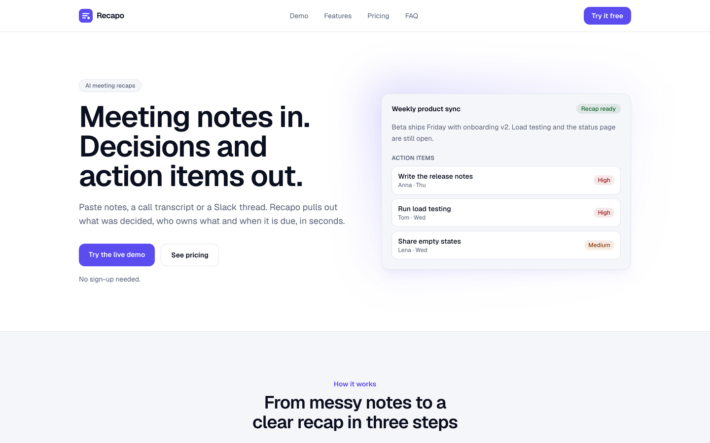
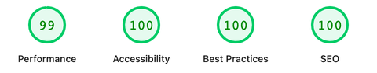
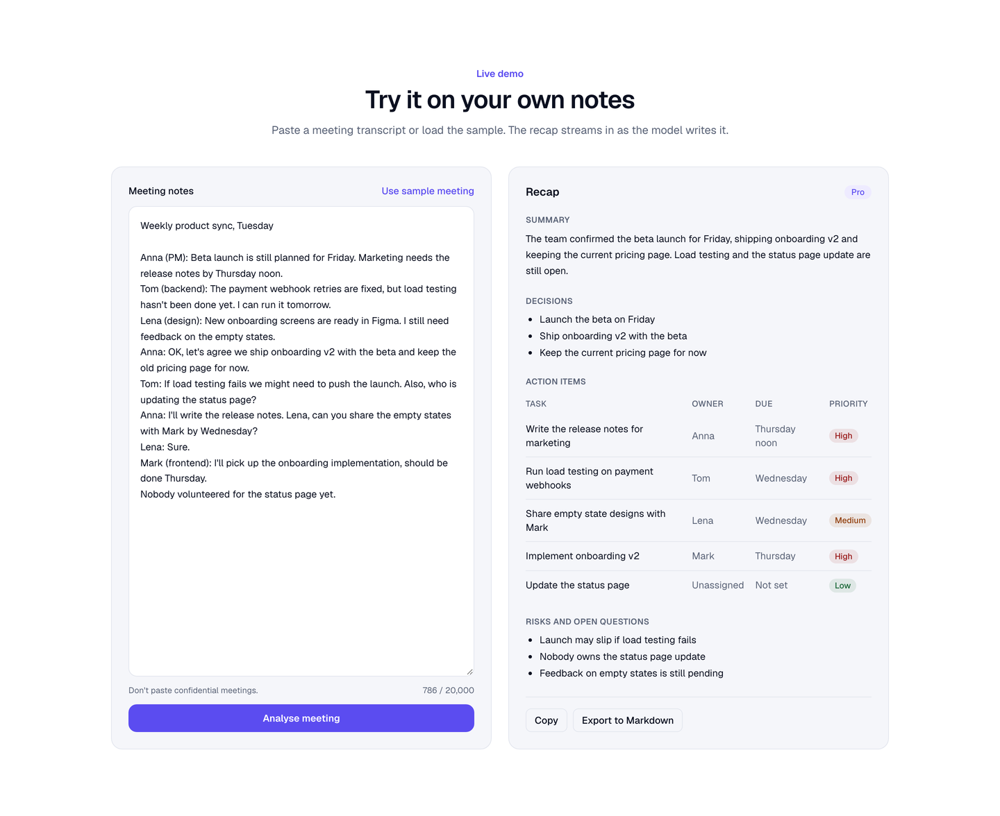
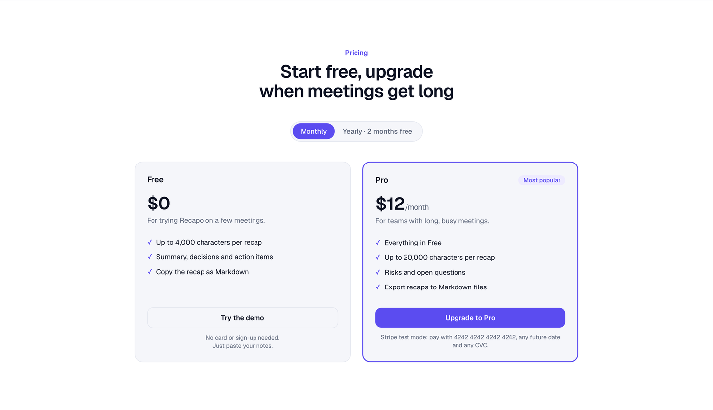
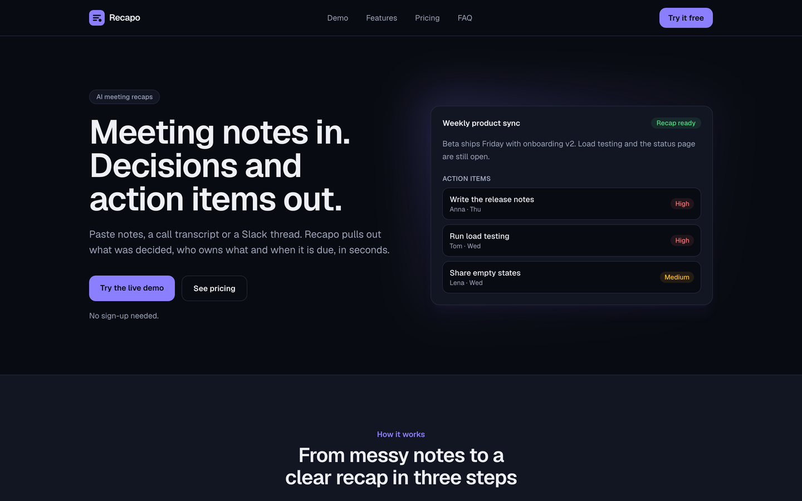
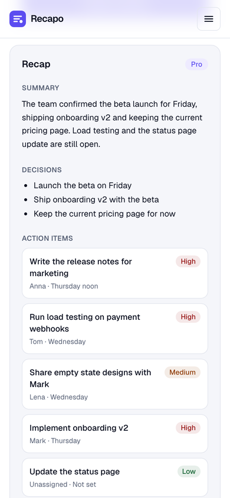

# Recapo

Paste meeting notes, a call transcript or a Slack thread and get a summary, decisions and action items with owners and due dates, streamed live while the model writes them.

**Live demo: [recapo-self.vercel.app](https://recapo-self.vercel.app)**



Recapo is a portfolio project. The AI analysis is real (Google Gemini through the Vercel AI SDK) and the upgrade flow is a real Stripe Checkout running in test mode, so no money is ever charged. Use the card `4242 4242 4242 4242` with any future date and any CVC to unlock Pro.

## What it shows

- **Streaming structured AI output.** The model returns a typed object validated by a Zod schema, and the UI renders each section as soon as it arrives instead of waiting for the full response.
- **Resilient model calls.** A language model middleware falls back to a second Gemini model when the primary is overloaded, unavailable or silent for 15 seconds, and the UI shows a sample result if both fail.
- **Stripe payments without a database.** Checkout runs in subscription mode with inline prices. After payment the server verifies the session with Stripe and sets a signed, httpOnly JWT cookie that unlocks Pro for 24 hours.
- **Plan-aware API.** Free and Pro have different input limits and output schemas (Pro adds risks and open questions), enforced on the server, with per-IP rate limiting.
- **Performance and accessibility.** Lighthouse mobile on production: 99 Performance, 100 Accessibility, 100 Best Practices, 100 SEO. The demo bundle loads only when it scrolls into view.



## Screenshots

| Live demo (Pro) | Pricing |
| --- | --- |
|  |  |

| Dark theme | Mobile |
| --- | --- |
|  |  |

## Stack

Next.js 16 (App Router, Cache Components), React 19, TypeScript (strict), Tailwind CSS 4, Motion, Vercel AI SDK 7 with `@ai-sdk/google`, Zod 4, Stripe, `jose`, Vitest, Playwright. Deployed on Vercel.

## How it works

```
Browser                                  Server (route handlers)                External
-------                                  -----------------------                --------
Demo (useObject) ---- POST notes ------> /api/analyze
                                           plan from cookie, length limit,
                                           rate limit, streamText + Output.object ---> Gemini (with fallback)
                 <--- streamed JSON ------
Upgrade button ------ POST interval ---> /api/checkout ---- create session -------> Stripe Checkout
Stripe redirect ----- session_id ------> /api/verify  ---- retrieve session -----> Stripe
                 <--- httpOnly plan cookie (signed JWT, 24 h)
PlanProvider -------- GET -------------> /api/plan (reads and verifies the cookie)
```

Project layout:

```
app/
  api/analyze     streamed AI analysis
  api/checkout    Stripe Checkout Session
  api/verify      payment verification, sets the plan cookie
  api/plan        current plan for the client
  opengraph-image.tsx, sitemap.ts, robots.ts
components/
  sections/       landing page sections
  demo/           demo input, streamed result, export
  pricing/        plans, upgrade button, checkout return
lib/
  schema.ts       Zod schema for free and pro results
  model.ts        Gemini model with fallback middleware
  plan-token.ts   JWT signing and verification
  rate-limit.ts   sliding window limiter
e2e/              Playwright tests
```

## Running locally

Requirements: Node.js 22, a Google AI Studio API key and a Stripe test secret key.

```bash
npm install
cp .env.example .env.local
npm run dev
```

| Variable | Purpose |
| --- | --- |
| `GOOGLE_GENERATIVE_AI_API_KEY` | Gemini API key from Google AI Studio |
| `GEMINI_MODEL` | Primary model, default `gemini-flash-lite-latest` |
| `GEMINI_FALLBACK_MODEL` | Fallback model, default `gemini-3.1-flash-lite` |
| `STRIPE_SECRET_KEY` | Stripe secret key, must start with `sk_test_` |
| `PLAN_TOKEN_SECRET` | At least 32 characters, for example `openssl rand -base64 32` |

`NEXT_PUBLIC_SITE_URL` is optional. On Vercel the site URL is taken from `VERCEL_PROJECT_PRODUCTION_URL`, and Stripe return URLs are built from the request origin.

## Tests

```bash
npm test            # Vitest: schema, plan token, rate limiter, Markdown export
npm run test:e2e    # Playwright: demo flow, error states, responsive layout
npm run lint
npm run typecheck
```

The Playwright suite runs against a production build on desktop and mobile viewports and mocks the AI endpoint, so it does not use the Gemini quota.

## Notes

- Notes are sent to Gemini for analysis and are not stored. The demo uses Gemini's free tier, where Google may use inputs to improve its models, so the UI asks people not to paste confidential meetings.
- The rate limiter is in memory per server instance. That is enough for a demo on a free model tier; a production version would use a shared store such as Redis.
